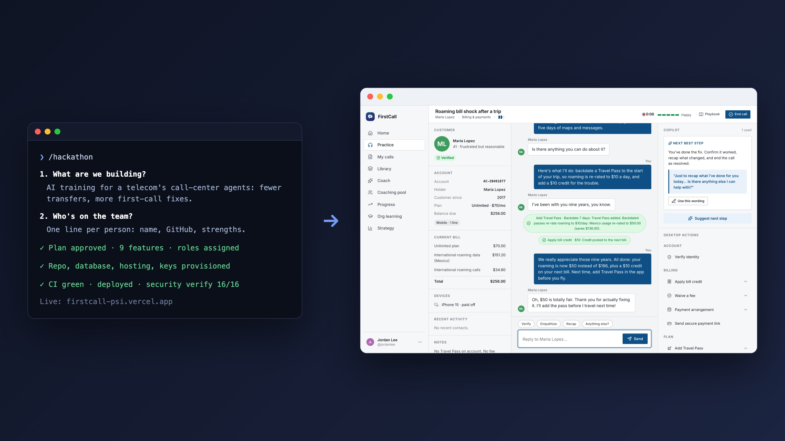

# Hackathon template

**From two questions to a live, secure app a whole team can build on**

**[Read the case study →](https://github.com/CB-viberrr/portfolio/blob/main/case-studies/hackathon-template.md)**

- **One command turns an idea and a team list into a live app:** repo, database, hosting, keys, roles and task sheets,
  with a security and design baseline in place from the first commit.
- **Built so 6–8 beginners can push to the same live site without breaking it:** file ownership enforced three ways,
  30 automated security tests, and failing pushes reverted automatically.
- **First full run: [FirstCall](https://github.com/CB-viberrr/portfolio/blob/main/case-studies/firstcall.md),** a 9-feature AI training platform built in one day and live from the
  first hour.

---
This repository is a showcase: the code is private. A walkthrough or read access is available on request.
More work: [portfolio](https://github.com/CB-viberrr/portfolio) · © 2026 Charles Bingaman
